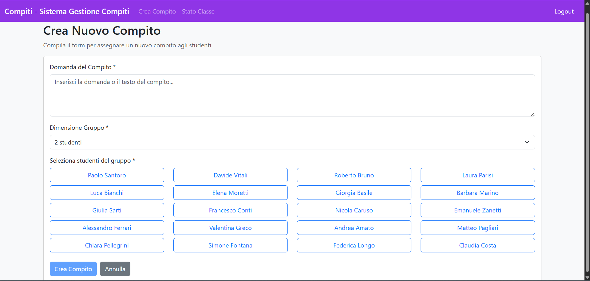
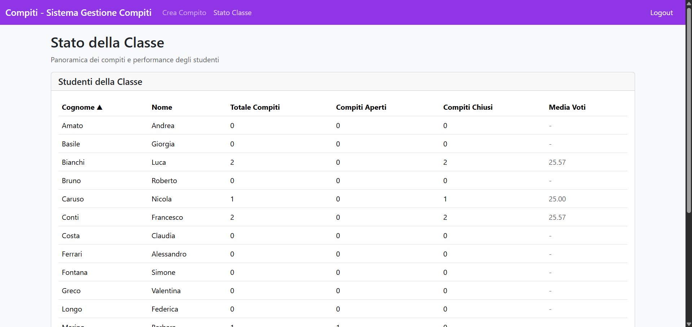

[](https://classroom.github.com/a/F9jR7G97)
# Exam #2: "Compiti"
## Student: s347320 GIROLAMI SOFIA 

## React Client Application Routes

- Route `/`: Homepage, pagina iniziale dove fare il login, è disponibile solo se non si è loggati
- Route `/login`: Pagina del login per autenticarsi tramite credenziali

- Route `/professori/:id_prof`: Dashboard del professore in cui vede: il numero di compiti totali; quelli aperti che non hanno ancora ricevuto una risposta; quelli da valutare, cioè aperti con una risposta; quelli valutati, cioè quelli a cui è stata assegnata una valutazione e quindi sono chiusi. In questa pagina vede anche la sezione 'Gestisci compiti' in cui può visualizzare i dettagli di quelli chiusi e valutare quelli aperti.
- Route `/professori/:id_prof/compiti/new`: Il professore può creare nuovi compiti scrivendo la domanda, scegliendo il numero di studenti che formeranno il gruppo e selezionando tali studenti.
- Route `/professori/:id_prof/statoclasse`: Qui il professore vede una panoramica degli studenti con il rispettivo numero di compiti aperti e chiusi e la media (ovviamente solo dei suoi compiti). Può ordinare questa lista in base a totcmpiti, media o in ordine alfabetico cliccando sul nome della colonna (ordine sia crescente che descrescente).

- Route `/studenti/:id_studente`: Dashboard dello studente in cui vede il numero totale di compiti in cui è coinvolto, il numero di compiti ancora aperti e il numero di compiti chiusi e quindi già valutati. In questa pagina vede anche la sezione 'I miei compiti' dove può vedere i dettagli dei compiti chiusi con i rispettivi voti, rispondere ai nuovi compiti o modificare delle risposte già date.
- Route `/studenti/:id_studente/compiti/:id_compito`: Pagina in cui lo studente visualizza i dettagli del compito selezionato, se chiuso, o può risondere alla domanda/modificare la risposta se ancora aperto.

- Route `*`: Not Found Page, se l'utnte finisce in route che non esistono viene reinderizzato in questa pagina.

## API Server

### Autenticazione

- POST `/api/sessions`
  - Descrizione: autenticazione utente tramite username e password
  - Request body: oggetto JSON con credenziali dell'utente
    ```
    {
      "username": "frossi",
      "password": "password456"
    } 
    ```
  - Response: 
    - `201 Created`: in caso di successo.
    - `401 Unauthorized`: in caso di credenziali errate.
  - Response body: oggetto che contiene informazioni sull'utente in caso di successo
    ```
    {
      "id_utente": 1,
      "username": "frossi",
      "nome": "Franco",
      "cognome": "Rossi",
      "ruolo": "professore"
    }
    ```

- GET `/api/sessions/current`
  - Descrizione: restituisce la descrizione dell'utente correntemente autenticato nella sessione
  - Response: 
    - `200 OK`: in caso di successo.
    - `401 Unauthorized`: se l'utente non è autenticato.
  - Response body:
    ```
    {
      "id_utente": 1,
      "username": "frossi",
      "nome": "Franco",
      "cognome": "Rossi",
      "ruolo": "professore"
    }
    ```

- DELETE `/api/sessions/current`
  - Descrizione: elimina la sessione corrente ed effettua il logout dell'utente
  - Response:
    - `200 OK`: in caso di successo.


### Compiti

- GET `/api/compiti/:id_compito`
  - Descrizione: restituisce i dettagli del compito corrispondente all'id
  - Response: 
    - `200 OK`: in caso di successo
    - `404 Not Found`: se il compito non esiste
    - `401 Unauthorized`: se non autenticato
    - `500 Internal Server Error`: errore del server
  - Response body:
    ```
    {
      "id_compito": 1,
      "domanda": "Quale fu la causa dello scoppio della seconda guerra mondiale?",
      "id_prof": 1,
      "dimensione_gruppo": 4,
      "stato": "chiuso",
      "risposta": "La causa fu l'invasione della Polonia da parte della Germania nazista nel 1939.",
      "voto": 28
    }
    ```

- PUT `/api/compiti/:id_compito/risposta`  
  - Response:
    - `200 OK`: risposta inserita/aggiornata con successo
    - `401 Unauthorized`: se non autenticato
    - `403 Forbidden`: se non è uno studente o non autorizzato al compito
    - `404 Not Found`: compito non trovato/non accessibile/già chiuso
    - `422 Unprocessable Entity`: errori di validazione
    - `503 Service Unavailable`: errore nell'aggiornamento
 - Response body:
  ```
  {
    "message": "Risposta aggiornata con successo"
  }
  ```

- PUT `/api/compiti/:id_compito/voto`
  - Response:
    - `200 OK`: voto assegnato con successo
    - `400 Bad Request`: il compito non ha risposta da valutare
    - `401 Unauthorized`: se non autenticato
    - `403 Forbidden`: se non è professore o non autorizzato
    - `404 Not Found`: compito non trovato
    - `422 Unprocessable Entity`: voto non valido (0-30)
    - `503 Service Unavailable`: errore nell'inserimento
  - Response body:
    ```
    {
      "success": true
    }
    ```

### Studenti

- GET `/api/studenti`
  - Response:
    - `200 OK`: lista studenti restituita
    - `401 Unauthorized`: se non autenticato
    - `403 Forbidden`: se non è professore
    - `500 Internal Server Error`: errore del server
  - Response body:
    ```
    [
    {
      "id_utente": 3,
      "username": "psantoro",
      "password_hash": "d75555bb484a08e6b9b9e9ae546e625b1dee5bfd65521cab50cc248cd7ff9671",
      "salt": "344bcd4d3898f5b082661d3a74f74cc6",
      "ruolo": "studente",
      "nome": "Paolo",
      "cognome": "Santoro"
    },
    {
      "id_utente": 4,
      "username": "lbianchi",
      "password_hash": "677d30eb1f71d45ed151f6f12032d4ee18f47585c7ec8b45db1148ca684bafb7",
      "salt": "eee2c7acb694b8128d6f7f3cd79679e8",
      "ruolo": "studente",
      "nome": "Luca",
      "cognome": "Bianchi"
    },
    ...
    ]
    ```

- GET `/api/studenti/:id_studente`
  - Response:
    - `200 OK`: studente trovato
    - `401 Unauthorized`: se non autenticato
    - `404 Not Found`: studente non trovato
    - `500 Internal Server Error`: errore del server
  - Response body:
    ```
    {
      "id_utente": 4,
      "username": "lbianchi",
      "password": "677d30eb1f71d45ed151f6f12032d4ee18f47585c7ec8b45db1148ca684bafb7",
      "salt": "eee2c7acb694b8128d6f7f3cd79679e8",
      "ruolo": "studente",
      "nome": "Luca",
      "cognome": "Bianchi"
    } 
    ```
- GET `/api/studenti/:id_studente/compiti`
  - Response:
    - `200 OK`: compiti dello studente
    - `401 Unauthorized`: se non autenticato
    - `403 Forbidden`: se non è studente o accede a dati di altri
    - `404 Not Found`: nessun compito trovato
    - `500 Internal Server Error`: errore del server
  - Response body:
    ```
    [
    {
      "id_compito": 1,
      "domanda": "Quale fu la causa dello scoppio della seconda guerra mondiale?",
      "id_prof": 1,
      "dimensione_gruppo": 4,
      "stato": "chiuso",
      "risposta": "La causa fu l'invasione della Polonia da parte della Germania nazista nel 1939.",
      "voto": 25
    },
    {
      "id_compito": 2,
      "domanda": "Come si conclude la seconda guerra mondiale?",
      "id_prof": 1,
      "dimensione_gruppo": 3,
      "stato": "chiuso",
      "risposta": "Si conlcude nel 1945 con la sconfitta delle potenze dell'Asse da parte degli Alleati",
      "voto": 26
    },
    {
      "id_compito": 3,
      "domanda": "Qual è la capitale del Sud Corea?",
      "id_prof": 1,
      "dimensione_gruppo": 2,
      "stato": "chiuso",
      "risposta": "Seoul",
      "voto": 23
    },
    ...
    ]
    ```

### Professori

- GET `/api/professori/:id_prof/compiti`
  - Descrizione: restituisce tutti i compiti creati da un professore
  - Response:
    - `200 OK`: in caso di successo
    - `401 Unauthorized`: se non autenticato
    - `403 Forbidden`: se non è professore
    - `500 Internal Server Error`: errore del server
  - Response body:
    ```
    [
    {
      "id_compito": 1,
      "domanda": "Quale fu la causa dello scoppio della seconda guerra mondiale?",
      "id_prof": 1,
      "dimensione_gruppo": 4,
      "stato": "chiuso",
      "risposta": "La causa fu l'invasione della Polonia da parte della Germania nazista nel 1939.",
      "voto": 25
    },
    {
      "id_compito": 2,
      "domanda": "Come si conclude la seconda guerra mondiale?",
      "id_prof": 1,
      "dimensione_gruppo": 3,
      "stato": "chiuso",
      "risposta": "Si conlcude nel 1945 con la sconfitta delle potenze dell'Asse da parte degli Alleati",
      "voto": 26
    },
    {
      "id_compito": 3,
      "domanda": "Qual è la capitale del Sud Corea?",
      "id_prof": 1,
      "dimensione_gruppo": 2,
      "stato": "chiuso",
      "risposta": "Seoul",
      "voto": 23
    },
    ...
    ]
    ```

- GET `/api/professori/:id_prof/statoclasse`
  - Descrizione: restituisce una panoramica degli studenti con statistiche sui compiti
  - Response:
    - `200 OK`: in caso di successo
    - `401 Unauthorized`: se non autenticato
    - `403 Forbidden`: se non è professore
    - `500 Internal Server Error`: errore del server
  - Response body:
    ```
    [
    {
      "id_utente": 6,
      "nome": "Alessandro",
      "cognome": "Ferrari",
      "username": "aferrari",
      "totale_compiti": 0,
      "aperti": 0,
      "chiusi": 0,
      "media_voti": null
    },
    {
      "id_utente": 16,
      "nome": "Andrea",
      "cognome": "Amato",
      "username": "aamato",
      "totale_compiti": 1,
      "aperti": 0,
      "chiusi": 1,
      "media_voti": 26
    },
    {
      "id_utente": 19,
      "nome": "Barbara",
      "cognome": "Marino",
      "username": "bmarino",
      "totale_compiti": 0,
      "aperti": 0,
      "chiusi": 0,
      "media_voti": null
    },
    {
      "id_utente": 7,
      "nome": "Chiara",
      "cognome": "Pellegrini",
      "username": "cpellegrini",
      "totale_compiti": 1,
      "aperti": 0,
      "chiusi": 1,
      "media_voti": 25
    },
    ...
    ]
    ```

- GET `/api/verifica-coppia/:id_studente1/:id_studente2/:id_prof`
  - Descrizione: verifica se due studenti possono lavorare insieme
  - Response:
    - `200 OK`: in caso di successo
    - `401 Unauthorized`: se non autenticato
    - `403 Forbidden`: se non è professore
    - `500 Internal Server Error`: errore del server
  - Response body:
    ```
    {
      "puo_lavorare_insieme": true
    }
    ```

- POST `/api/professori/:id_prof/compiti/new`
  - Response body:
    ```
    {
      "id": 8
    }
    ```

### Gruppi

- GET `/api/gruppi/compito/:id_compito`
  - Descrizione: restituisce tutti i membri del gruppo per un compito specifico
  - Response:
    - `200 OK`: in caso di successo
    - `401 Unauthorized`: se non autenticato
    - `404 Not Found`: se il compito non esiste
    - `500 Internal Server Error`: errore del server
  - Response body:
    ```
    [
    {
      "id_utente": 4,
      "nome": "Luca",
      "cognome": "Bianchi"
    },
    {
      "id_utente": 7,
      "nome": "Chiara",
      "cognome": "Pellegrini"
    },
    {
      "id_utente": 10,
      "nome": "Francesco",
      "cognome": "Conti"
    },
    {
      "id_utente": 15,
      "nome": "Nicola",
      "cognome": "Caruso"
    }
    ]
    ```

- POST `/api/gruppi`
  - Descrizione: crea un nuovo gruppo per un compito
  - Response:
    - `200 OK`: gruppo creato con successo
    - `401 Unauthorized`: se non autenticato
    - `422 Unprocessable Entity`: errori di validazione
    - `500 Internal Server Error`: errore del server
  - Response body:
    ```
    {
      "id": 18
    }
    ```

## Database Tables

- Table `Compiti` - contiene tutti i compiti creati, i campi sono: id_compito, domanda, id_prof, dimensione_gruppo, stato, risposta, voto
- Table `Gruppi` - contiene i gruppi per ogni compito, i campi sono: id_task, id_studente
- Table `Utenti` - contiene tutti gli utenti, i campi sono: id_utente, username, password_hash, salt, ruolo, nome, cognome

## Main React Components

- `HomePage` (in `HomePage.jsx`): Pagina di benvenuto con presentazione del sistema e il login. Include sezioni informative sui ruoli (docenti/studenti) e funzionalità principali.

- `LoginForm` (in `Login.jsx`): Componente per l'autenticazione utente con form di login. Utilizza `useActionState` per gestire lo stato del form.

- `TeacherDashboard` (in `TeacherDashboard.jsx`): Dashboard principale del professore con statistiche sui compiti (creati, aperti, da valutare, valutati), tabella di gestione compiti e modal per la valutazione e la visualizzazione dettagli. 

- `StudentDashboard` (in `StudentDashboard.jsx`): Dashboard dello studente con statistiche personali (totale compiti, in valutazione, valutati, media voti), panoramica dei compiti assegnati e possibilità di visualizzare i compiti chiusi e rispondere a quelli aperti.

- `CreateAssignment` (in `CreateAssignment.jsx`): Form per la creazione di nuovi compiti da parte del professore. Include selezione studenti per il gruppo e validazione delle coppie di lavoro.

- `MyAssignments` (in `MyAssignments.jsx`): Pagina di dettaglio del singolo compito per lo studente. Permette di visualizzare domanda, membri del gruppo, inserire/modificare risposte (se aperto) o visualizzare risultati (se chiuso).

- `ClassStatus` (in `ClassStatus.jsx`): Panoramica dello stato della classe per il professore con tabella degli studenti, statistiche sui compiti per ciascuno e funzionalità di ordinamento (alfabetico, per numero compiti, per media voti).

## Screenshot





## Users Credentials
### Professori
- frossi, password456
- gverdi, password456

### Studenti
Gli studenti lbianchi e fconti hanno già lavorato insieme a 2 compiti per il prof frossi

- psantoro, password123
- lbianchi, password123
- gsarti, password123
- aferrari, password123
- cpellegrini, password123
- dvitali, password123
- emoretti, password123
- fconti, password123
- vgreco, password123
- sfontana, password123
- rbruno, password123
- gbasile, password123
- ncaruso, password123
- aamato, password123
- flongo, password123
- lparisi, password123
- bmarino, password123
- ezanetti, password123
- mpagliari, password123
- ccosta, password123

